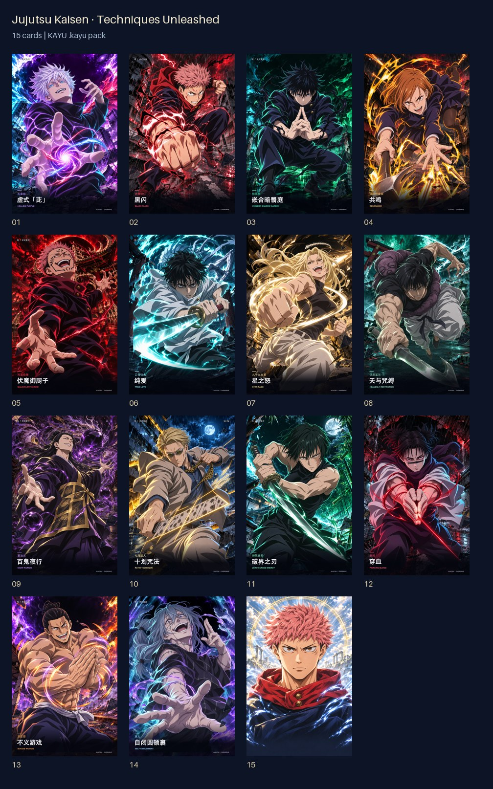
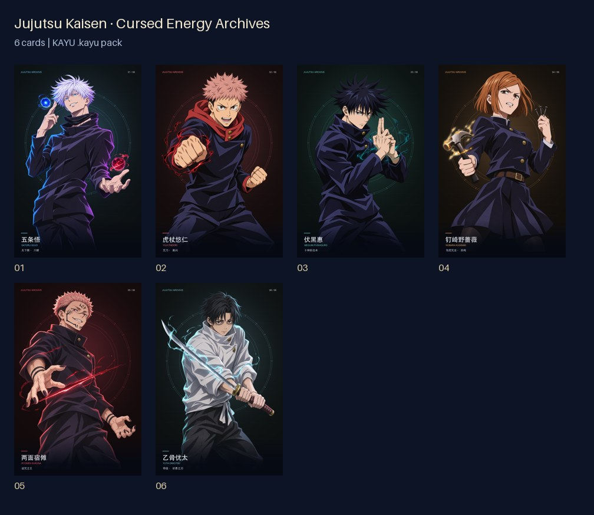
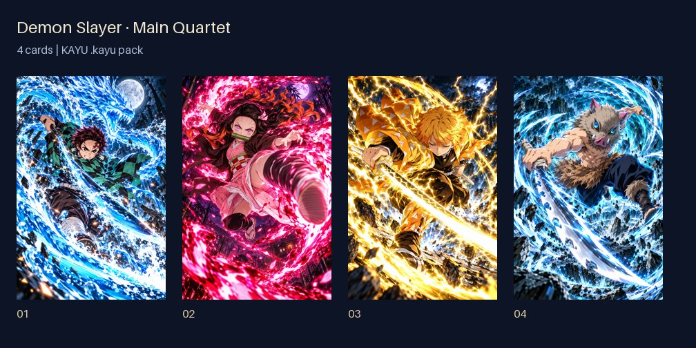

# インポートできるファンアートのカードパック

[English](README.md) · [简体中文](README.zh-CN.md) · **日本語**

下の `.kayu` ファイルをダウンロードし、iPhone の「ファイル」アプリに保存してください。KAYU で「Import Local File」（英語 UI）を選ぶと、「Packs」に未開封のパックとして保存されます。好きなときに開封してアルバムに追加できます。GitHub のページ URL ではなく、実際のファイルをダウンロードしてください。

元のイラスト、位置合わせ済みの透明レイヤー、光学効果の設定を保持しています。「柱」パックには修正済みのポーズ、産屋敷耀哉、柱の集合イラストを収録。「術式全開」には釘崎と東堂の手の修正版と、傾けると 2 枚の画像が切り替わる特別カードを収録しています。初期の 6 枚のシリーズは別パックです。

| コレクション | 枚数 | サイズ | ダウンロード |
|---|---:|---:|---|
| 呪術廻戦 · 術式全開 | 15 | 111.8 MiB | [.kayu をダウンロード](https://github.com/WangQvQ/kayu/releases/download/card-packs-v1.0.0/jujutsu-techniques.kayu) |
| 呪術廻戦 · 呪力アーカイブ | 6 | 27.8 MiB | [.kayu をダウンロード](https://github.com/WangQvQ/kayu/releases/download/card-packs-v1.0.0/jujutsu-archives.kayu) |
| 鬼滅の刃 · 主人公チーム | 4 | 63.6 MiB | [.kayu をダウンロード](https://github.com/WangQvQ/kayu/releases/download/card-packs-v1.0.0/demon-slayer-main.kayu) |
| 鬼滅の刃 · 柱 | 11 | 163.9 MiB | [.kayu をダウンロード](https://github.com/WangQvQ/kayu/releases/download/card-packs-v1.0.0/demon-slayer-hashira.kayu) |

## カードのプレビュー

### 呪術廻戦 · 術式全開

### 呪術廻戦 · 呪力アーカイブ

### 鬼滅の刃 · 主人公チーム

### 鬼滅の刃 · 柱

## ファイルの検証と素材について

Release には `SHA256SUMS.txt` が含まれます。カード一覧とファイルハッシュは [catalog.json](catalog.json) にも記録しています。すべての画像をパックに埋め込んでいるため、ダウンロード後のインポートはオフラインで行えます。API キーは不要です。

非公式の AI 支援によるファンアートです。キャラクターと作品の権利は、それぞれの権利者に帰属します。イラストとダウンロード用パックは、このリポジトリの MIT ライセンスの対象外です。個別にダウンロードするコンテンツであり、App Store 版のアプリには同梱していません。
