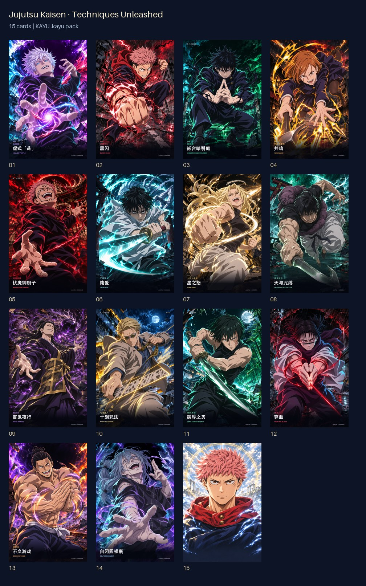
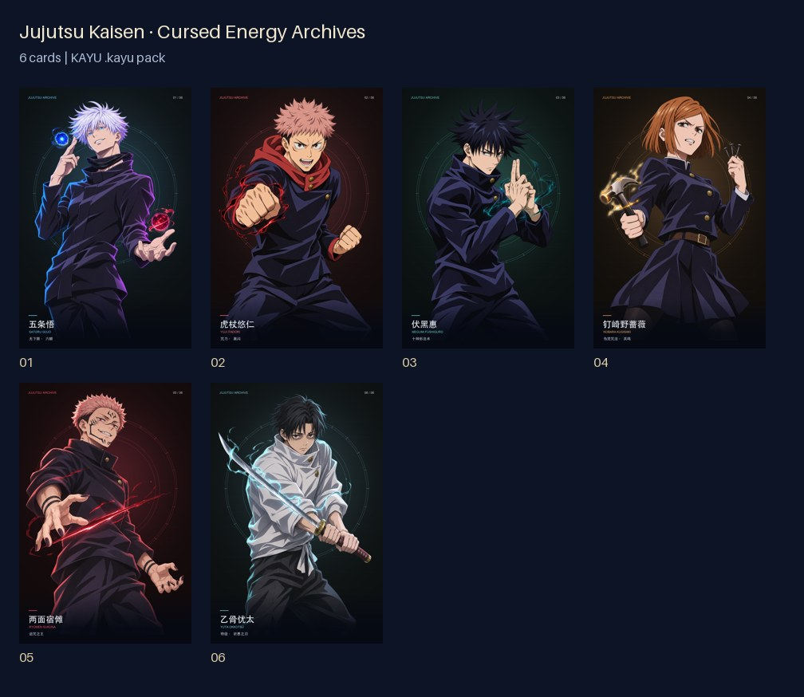
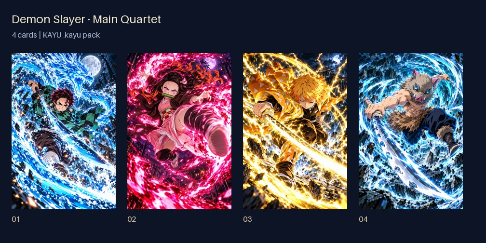
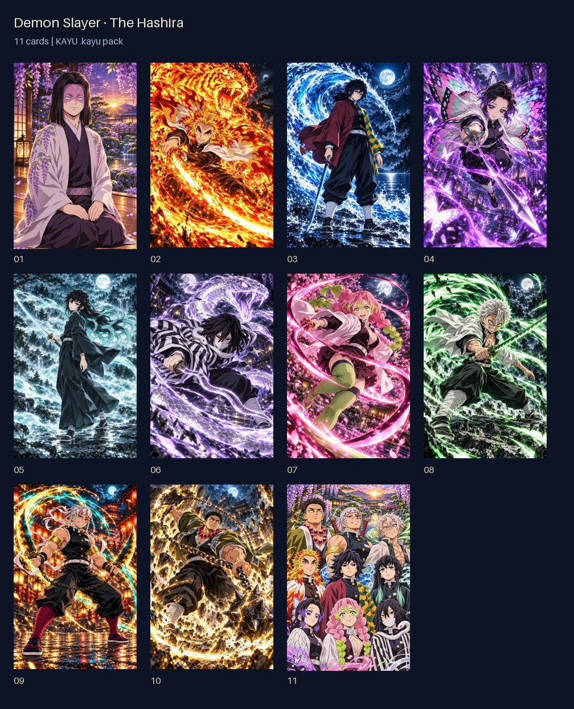

# Importable fan card packs

Download a `.kayu` file below and save it to the iPhone Files app. In KAYU, choose **Import Local File**. The pack appears under **Packs**, unopened. Open it when ready, then collect its cards into an album. A GitHub webpage URL is not an importable pack; download the actual file first.

Existing illustrations, registered transparent layers and optical settings are preserved. The Hashira pack uses the corrected poses and includes Kagaya and the group portrait. Techniques Unleashed uses the hand-corrected Nobara and Todo cards and includes the two-image tilt-switching special card. The earlier six-card Jujutsu collection is offered separately.

| Collection | Cards | File size | Download |
|---|---:|---:|---|
| Jujutsu Kaisen · Techniques Unleashed | 15 | 111.8 MiB | [Download .kayu](https://github.com/WangQvQ/kayu/releases/download/card-packs-v1.0.0/jujutsu-techniques.kayu) |
| Jujutsu Kaisen · Cursed Energy Archives | 6 | 27.8 MiB | [Download .kayu](https://github.com/WangQvQ/kayu/releases/download/card-packs-v1.0.0/jujutsu-archives.kayu) |
| Demon Slayer · Main Quartet | 4 | 63.6 MiB | [Download .kayu](https://github.com/WangQvQ/kayu/releases/download/card-packs-v1.0.0/demon-slayer-main.kayu) |
| Demon Slayer · The Hashira | 11 | 163.9 MiB | [Download .kayu](https://github.com/WangQvQ/kayu/releases/download/card-packs-v1.0.0/demon-slayer-hashira.kayu) |

## Card previews

### Jujutsu Kaisen · Techniques Unleashed

五条悟 · 虚式「茈」, 虎杖悠仁 · 黑闪, 伏黑惠 · 嵌合暗翳庭, 钉崎野蔷薇 · 共鸣, 两面宿傩 · 伏魔御厨子, 乙骨忧太 · 纯爱, 九十九由基 · 星之怒, 伏黑甚尔 · 天与咒缚, 夏油杰 · 百鬼夜行, 七海建人 · 十划咒法, 禅院真希 · 破界之刃, 胀相 · 穿血, 东堂葵 · 不义游戏, 真人 · 自闭圆顿裹, 一念神魔.

### Jujutsu Kaisen · Cursed Energy Archives

五条悟, 虎杖悠仁, 伏黑惠, 钉崎野蔷薇, 两面宿傩, 乙骨忧太.

### Demon Slayer · Main Quartet

竈门炭治郎, 竈门祢豆子, 我妻善逸, 嘴平伊之助.

### Demon Slayer · The Hashira

产屋敷耀哉, 炼狱杏寿郎, 富冈义勇, 蝴蝶忍, 时透无一郎, 伊黑小芭内, 甘露寺蜜璃, 不死川实弥, 宇髄天元, 悲鸣屿行冥, 九柱集结.

## Integrity and artwork

The release includes `SHA256SUMS.txt`. File hashes and card inventories are also recorded in [catalog.json](catalog.json). All pack resources are embedded; no service key or network connection is needed to import a downloaded file.

These are unofficial, AI-assisted fan artworks. Character and franchise rights belong to their respective rights holders. Card illustrations and downloadable packs are outside the repository’s MIT license. They are separate downloads and are not bundled in the App Store app.
