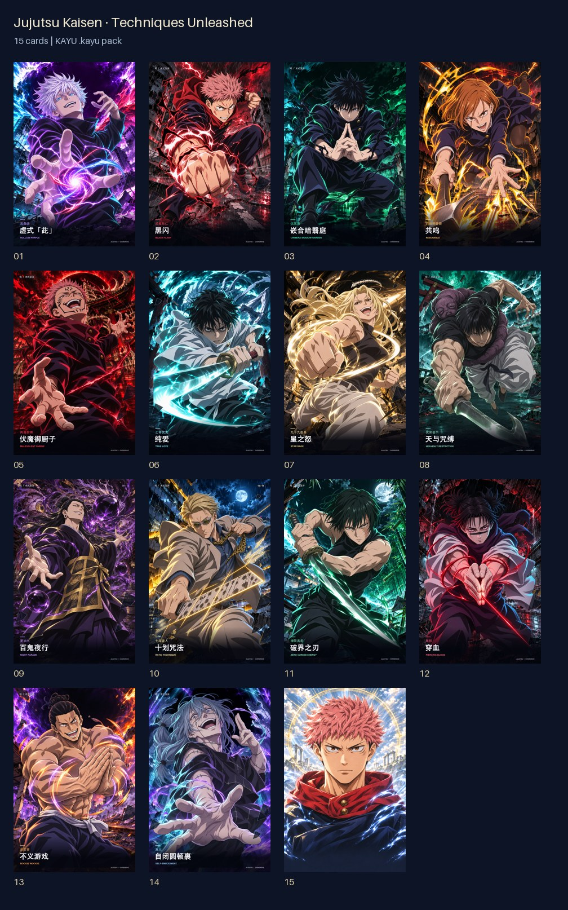
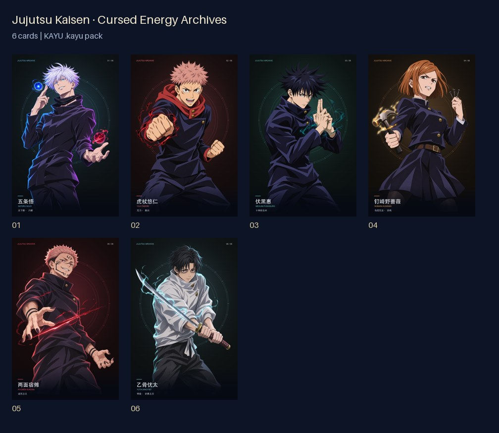
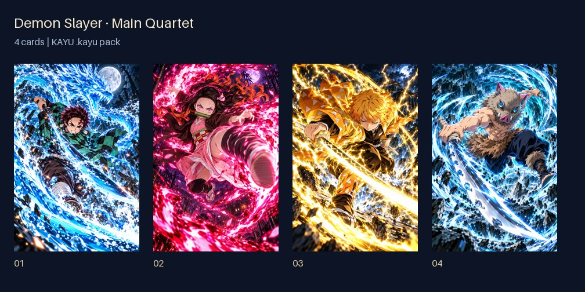

# 可导入的同人卡包

[English](README.md) · **简体中文** · [日本語](README.ja.md)

下载下方的 `.kayu` 文件，存到 iPhone 的「文件」App。在卡屿中选择「从本地文件导入」，卡包会先进入「卡包」的未拆封列表；准备好后再拆开、收进卡册。GitHub 网页链接不能直接导入，请先下载实际文件。

保留已有插画、真实透明图层及光学参数。「九柱」使用已修正的姿态，包含主公与九柱合影。「术式全开」采用钉崎和东堂的手部修正版，另附双图切换特别卡。早期六人系列单独提供。

| 系列 | 张数 | 文件大小 | 下载 |
|---|---:|---:|---|
| 咒术回战 · 术式全开 | 15 | 111.8 MiB | [下载 .kayu](https://github.com/WangQvQ/kayu/releases/download/card-packs-v1.0.0/jujutsu-techniques.kayu) |
| 咒术回战 · 咒力档案 | 6 | 27.8 MiB | [下载 .kayu](https://github.com/WangQvQ/kayu/releases/download/card-packs-v1.0.0/jujutsu-archives.kayu) |
| 鬼灭之刃 · 主角团 | 4 | 63.6 MiB | [下载 .kayu](https://github.com/WangQvQ/kayu/releases/download/card-packs-v1.0.0/demon-slayer-main.kayu) |
| 鬼灭之刃 · 九柱 | 11 | 163.9 MiB | [下载 .kayu](https://github.com/WangQvQ/kayu/releases/download/card-packs-v1.0.0/demon-slayer-hashira.kayu) |

## 卡面预览

### 咒术回战 · 术式全开

### 咒术回战 · 咒力档案

### 鬼灭之刃 · 主角团

### 鬼灭之刃 · 九柱

## 文件校验与素材说明

Release 提供 `SHA256SUMS.txt` 校验清单；[catalog.json](catalog.json) 记录卡片目录与文件哈希。素材全部嵌入卡包，已下载的文件可离线导入，不需要 API Key。

这些是非官方、AI 辅助创作的同人作品。角色及系列权利归相应权利人所有；卡面插画与可下载卡包不适用本仓库的 MIT 许可证。卡包是独立下载内容，不内置在 App Store 版本中。
